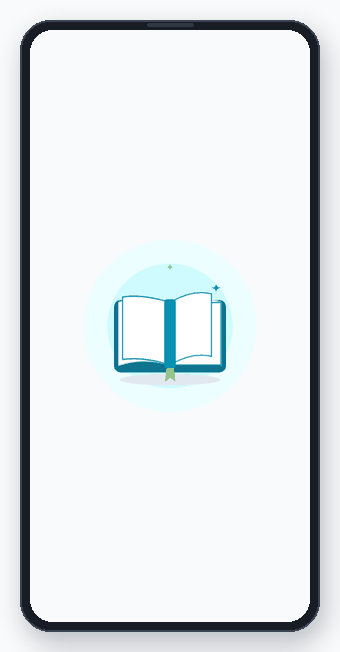
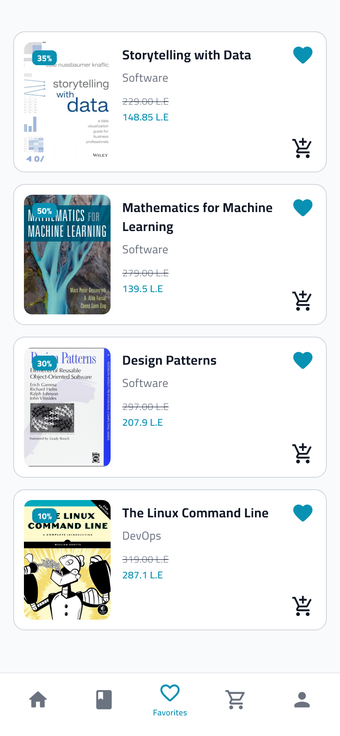
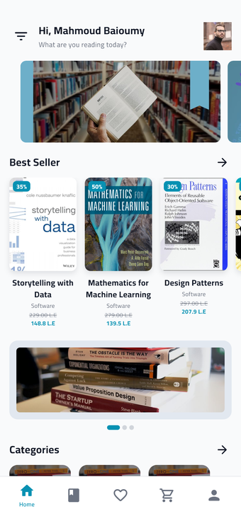
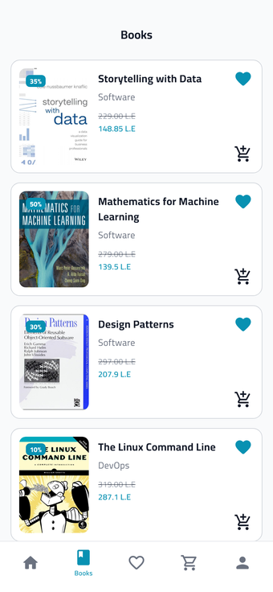
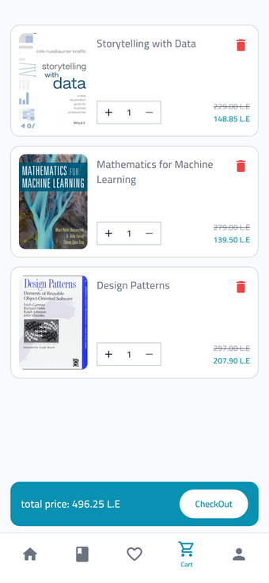
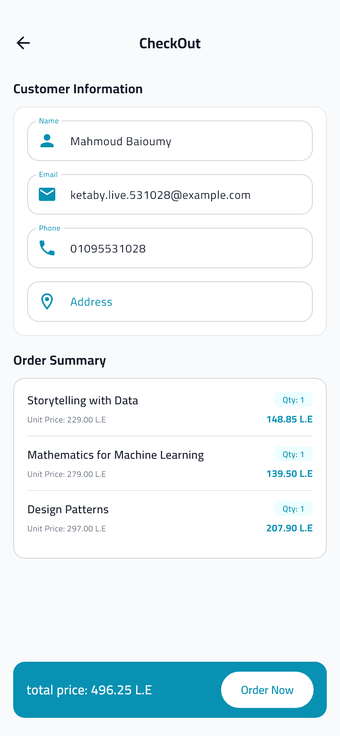
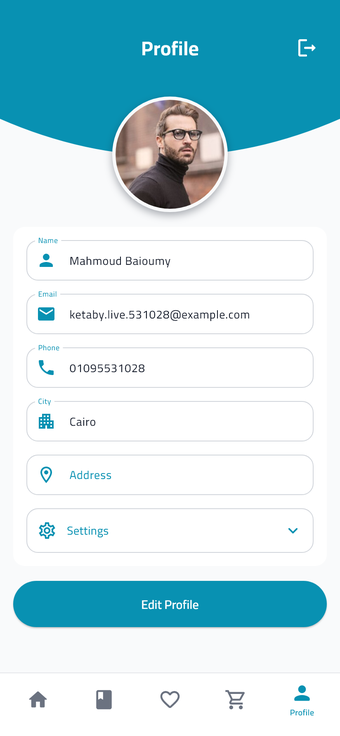
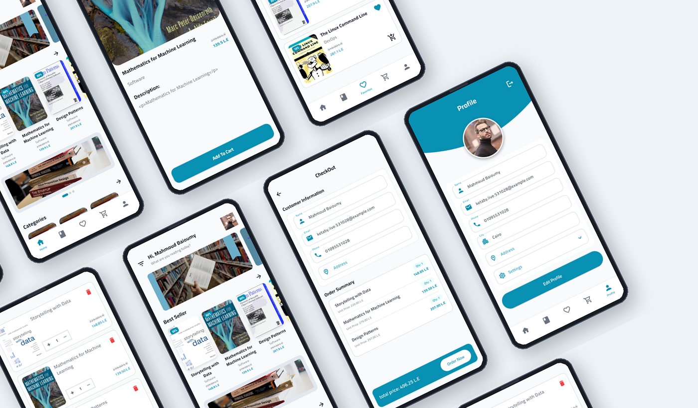
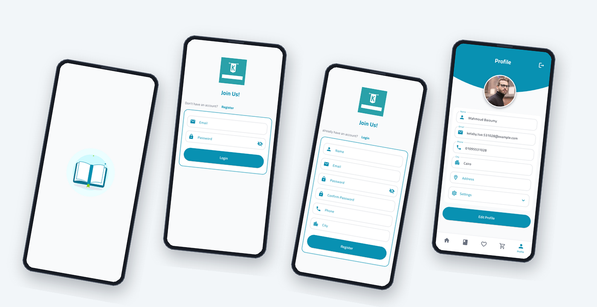

# 📚 Ketaby — Book Store App

A modern, full-featured **Flutter Book Store** application built with **Clean Architecture**, **Cubit (BLoC)** state management, **ViewModel-Cubit** separation, **Multi-Language Localization** (English, Arabic with full RTL, and German), and **Light / Dark Theme** support.

<p>
  <a href="https://flutter.dev/">
    
  </a>
  
  
  
</p>

---

### Splash Screen

A custom animated book splash screen with smooth flipping pages, pulsing brand glow rings, timed auto-navigation, and instant tap-to-skip support.



---

### Book Details

This screen provides complete information about any selected book — including full cover artwork, title, category, original and discounted prices, detailed description, instant favorite toggling, and a prominent **Add To Cart** action.


---

### Favorites

A dedicated **Wishlist** feature that lets you bookmark your favorite books with optimistic instant UI feedback and add them directly to your shopping cart whenever you're ready to buy.



---

### Onboarding Screens

A smooth, multi-step onboarding walkthrough introducing new users to the app experience before signing in or creating an account.


---

### Home

A dynamic **Book Store Home** screen featuring a personalized greeting header with user avatar, top featured carousel slider, **Best Seller** horizontal book cards with discount badges, promotional offer slider, **Categories**, and **New Arrivals** — all backed by live REST APIs and matching shimmer loading skeletons.



---

### Books Catalog

Browse the complete catalog of books with smooth staggered entrance animations, search filtering, discount tags, strikethrough pricing, quick favorite toggle, and one-tap **Add to Cart**.



---

### Shopping Cart & Checkout

Manage your selected books with interactive quantity controls (`+` / `-`), item removal, live total price calculation, pre-filled delivery details, an itemized **Order Summary**, and seamless one-tap **Order Now** checkout.

<p>
  
  &nbsp;&nbsp;&nbsp;&nbsp;
  
</p>

---

### Profile & Settings

A branded curved-header **Profile** screen displaying user details (`Name`, `Email`, `Phone`, `City`, `Address`), instant profile editing, quick **Language (EN / AR / DE)** and **Light / Dark Theme** switching, and secure session logout.



---

### Screenshots



<br />



---

## ✨ Key Features

- **Animated Splash & Onboarding** — Custom animated book splash screen with tap-to-skip and smart routing based on onboarding and session state.
- **Full Authentication Flow** — Login, Register, input validation, persistent session caching, and server-side logout.
- **Dynamic Home Feed** — Live sliders, Best Sellers, Promo Banners, Categories, and New Arrivals with shimmer placeholders and error retry.
- **Books Catalog & Details** — Searchable book list, staggered animations, discount badges, and rich book details view.
- **Wishlist & Cart** — Optimistic wishlist toggling, cart quantity steppers bounded by stock, and live order total calculation.
- **Complete Checkout** — Pre-filled customer delivery information, itemized order summary, and live order placement.
- **Profile, Multi-Language & Theming** — Editable profile, instant **English / Arabic (RTL) / German** switching, and **Light / Dark Mode**.

## 🛠️ Tech Stack

| Category | Packages / Tools |
| --- | --- |
| **Framework** | Flutter 3+, Material 3, Dart |
| **State Management** | `flutter_bloc` (Cubit), `ChangeNotifier` (ViewModels) |
| **Networking** | `dio`, `pretty_dio_logger`, `dartz` (`Either<Failure, T>`) |
| **Dependency Injection** | `get_it` |
| **Navigation** | `go_router` |
| **Localization** | `easy_localization` (EN, AR, DE) |
| **UI & UX** | `cached_network_image`, `shimmer`, `flutter_svg`, `bot_toast`, `pull_to_refresh_flutter3` |
| **Local Storage** | `shared_preferences` |

## 🚀 Getting Started

```bash
# 1. Clone the repository
git clone https://github.com/MahmoudBaioumy/NewBookApp.git
cd NewBookApp

# 2. Install dependencies
flutter pub get

# 3. Run the application
flutter run
```
